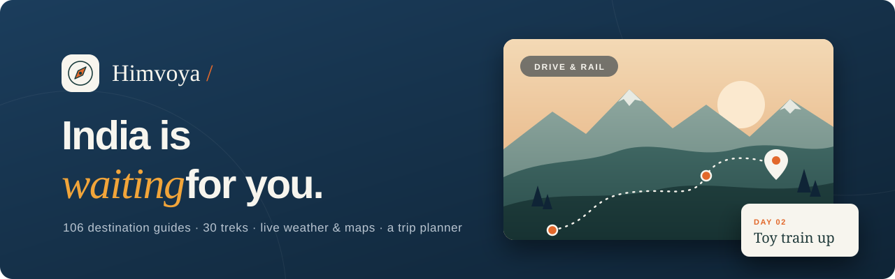
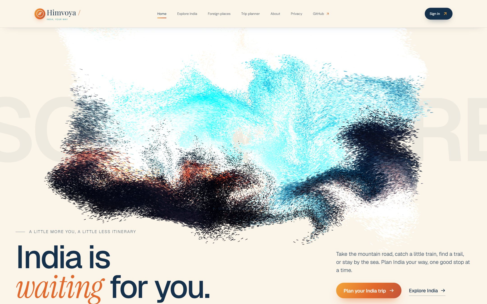
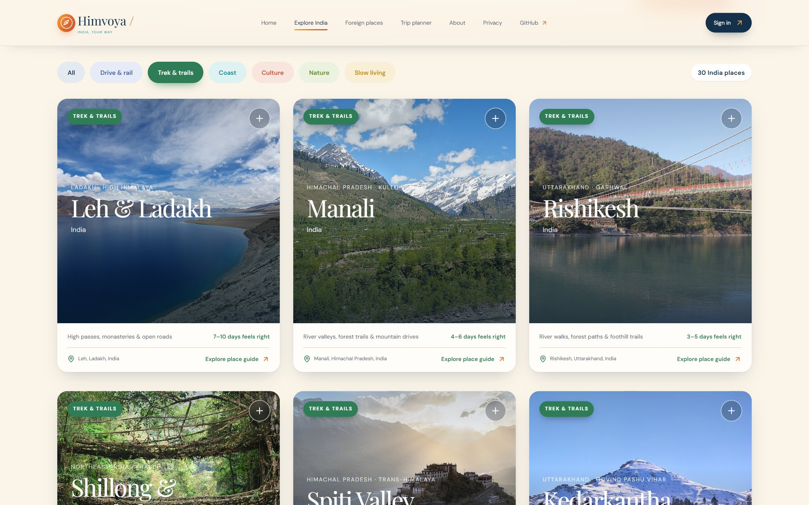
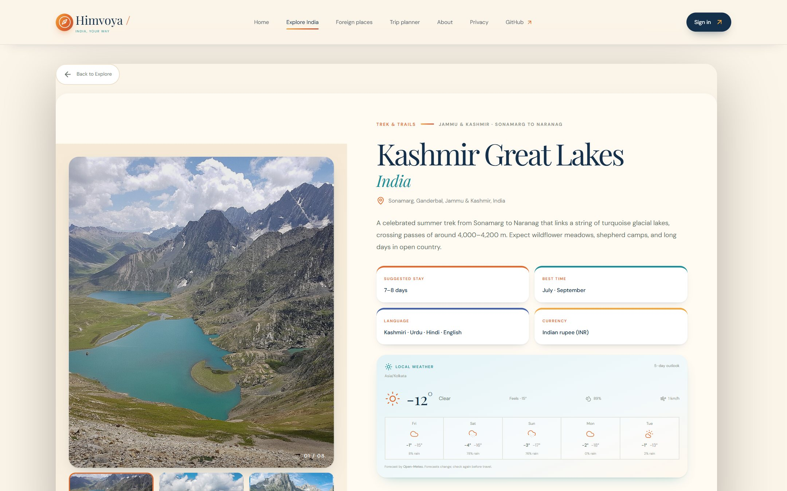
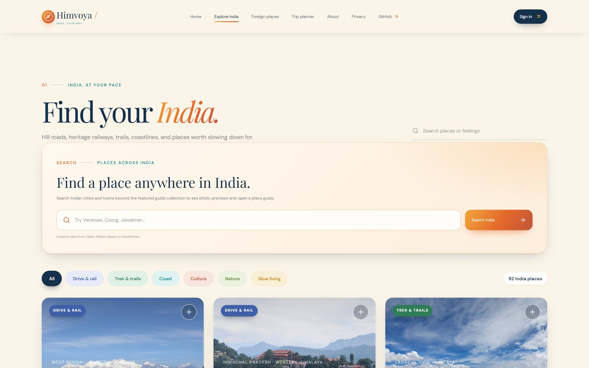
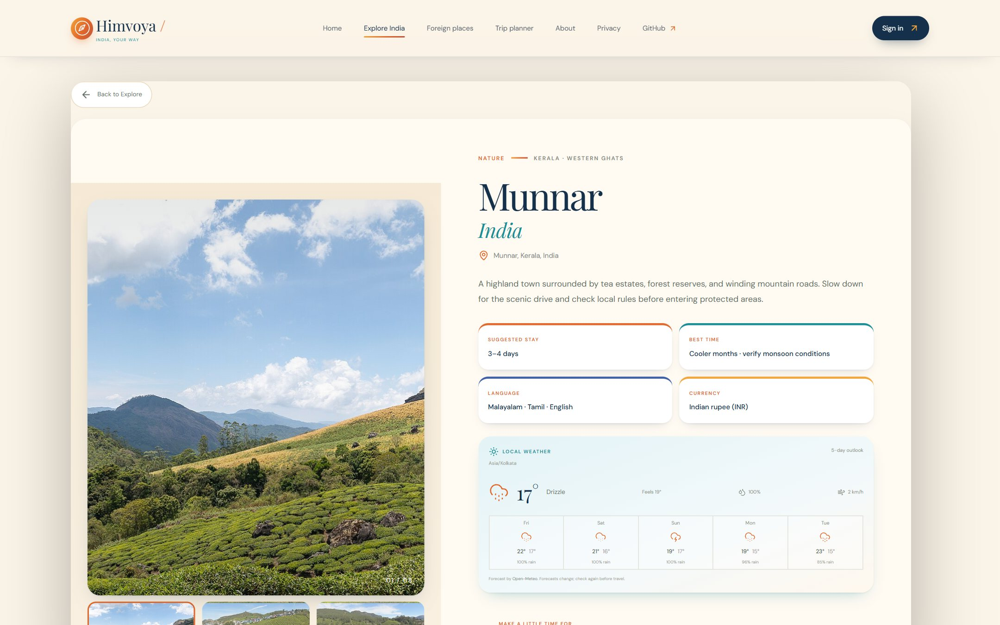
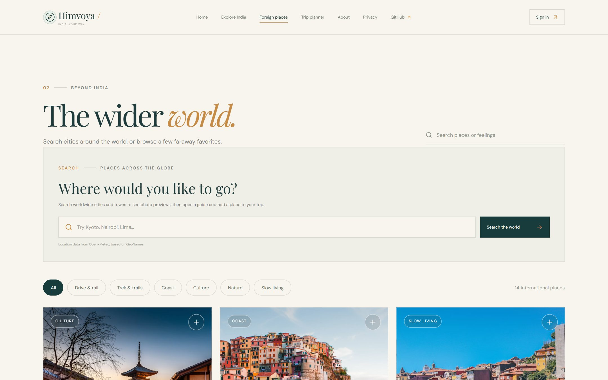
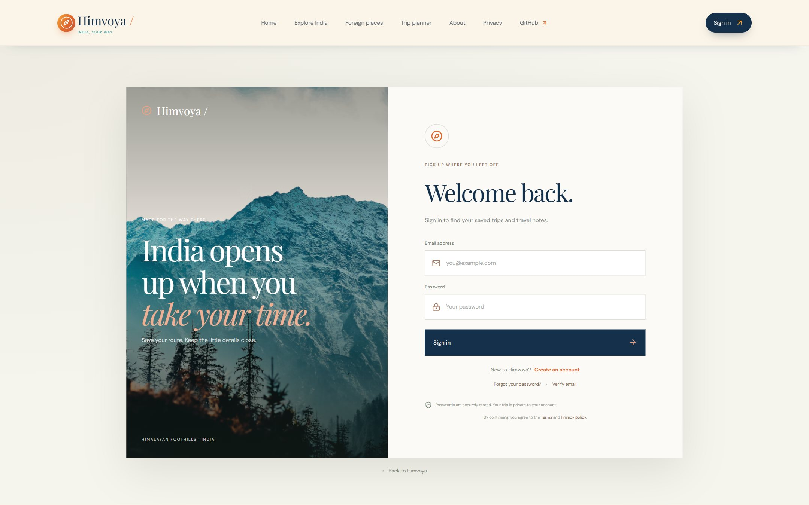
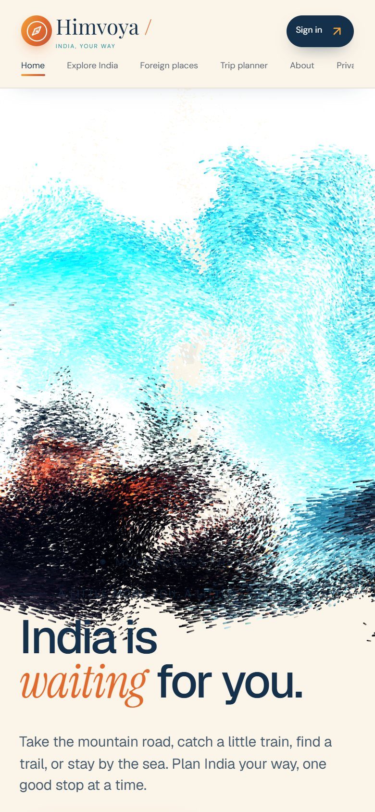
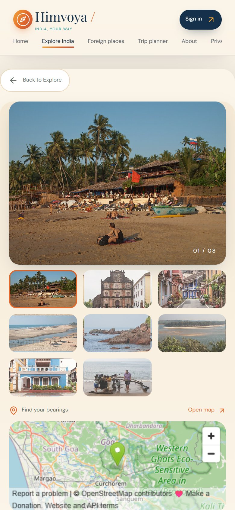

<p align="center">
  
</p>

<p align="center">
  <a href="https://himvoya-travel-planner.onrender.com/"></a>
  
  
  
  
</p>

<p align="center">
  <b><a href="https://himvoya-travel-planner.onrender.com/">Open the live site</a></b> ·
  <a href="#-features">Features</a> ·
  <a href="#%EF%B8%8F-treks">Treks</a> ·
  <a href="#-screenshots">Screenshots</a> ·
  <a href="#-design">Design</a> ·
  <a href="#-quick-start">Quick start</a> ·
  <a href="#%EF%B8%8F-deploy-to-render">Deploy</a> ·
  <a href="#-api">API</a>
</p>

---

**Himvoya** is an India-first travel planner. Browse hand-written guides to 106 destinations, 92 of them in India, from Himalayan treks and heritage railways to Kerala backwaters and tiger reserves, or search any city or town in the world. Each guide comes with photos, a map, a five-day forecast and ideas for what to see, eat and where to stay. Pick a few places and the trip planner sketches the days in between.

It is a React + TypeScript frontend and a small Express API in one Node process, storing accounts and trips in Node's built-in SQLite.

<p align="center">
  
</p>

## ✨ Features

<table>
<tr>
<td width="50%" valign="top">

### 🧭 India, at your pace
- **92 curated Indian destinations** across six moods: drive & rail, trek & trails, coast, culture, nature and slow living
- **30 mountain treks**, from Triund, Kedarkantha and Hampta Pass to Goecha La, Markha Valley and Kashmir Great Lakes
- Hill towns, heritage cities, beaches and tiger reserves, each colour-coded by mood
- Search **any Indian city or town** beyond the curated set
- Filter by mood, or search by place or feeling

</td>
<td width="50%" valign="top">

### 🌍 The wider world
- **14 international guides** in a separate Foreign Places section
- Worldwide city and town search (Open-Meteo / GeoNames)
- Photos from Wikimedia Commons, with attribution links

</td>
</tr>
<tr>
<td width="50%" valign="top">

### 📍 Guides worth reading
- **About 8 verified photos per guide** (over 800 in all), each credited to its photographer, plus map embeds and a **live five-day forecast**
- Sights, local transport, stay areas, food and nearby escapes
- Best time to visit, language, currency and planning notes

</td>
<td width="50%" valign="top">

### 🗓️ A planner that leaves room
- Dates, budget style, travellers, transport and stay type
- A **day-by-day first draft** of your itinerary
- Drafts save without an account; sign in to keep them

</td>
</tr>
<tr>
<td width="50%" valign="top">

### 🔐 Accounts done properly
- Email verification and password reset via [Resend](https://resend.com/)
- Cloudflare Turnstile on sign-up and recovery forms
- scrypt-hashed passwords and HttpOnly session cookies

</td>
<td width="50%" valign="top">

### 🛠️ Built to run
- One Node server for the site and `/api`
- Daily SQLite snapshots, health check, privacy-friendly analytics
- Mobile layouts, loading/empty/error states and a 404 page

</td>
</tr>
</table>

## 🏔️ Treks

Thirty mountain treks, from weekend walks to high-altitude crossings, each with the route, best season, permits and safety notes.

| Easy to moderate | Moderate | Challenging |
| --- | --- | --- |
| Rishikesh · Shillong & Meghalaya · Triund · Nag Tibba · Prashar Lake · Kheerganga · Chopta & Tungnath · Dzukou Valley · Kalsubai · Chembra Peak | Manali · Kedarkantha · Brahmatal · Dayara Bugyal · Kuari Pass · Hampta Pass · Har Ki Dun · Valley of Flowers · Sandakphu · Kudremukh · Harishchandragad | Kashmir Great Lakes · Tarsar Marsar · Roopkund · Goecha La · Markha Valley · Bhrigu Lake · Kedarnath · Leh & Ladakh · Spiti Valley |

<table>
<tr>
<td width="50%"><p align="center"><sub><b>Filter by mood</b>: 30 treks, colour-coded green</sub></p></td>
<td width="50%"><p align="center"><sub><b>Trek guide</b>: Kashmir Great Lakes, with live weather</sub></p></td>
</tr>
</table>

## 📸 Screenshots

<table>
<tr>
<td width="50%"><p align="center"><sub><b>Explore India</b>: search and filter by mood</sub></p></td>
<td width="50%"><p align="center"><sub><b>Place guide</b>: gallery, key facts and live weather</sub></p></td>
</tr>
<tr>
<td width="50%"><p align="center"><sub><b>Trip planner</b>: your trip, your tempo</sub></p></td>
<td width="50%"><p align="center"><sub><b>Foreign places</b>: search the wider world</sub></p></td>
</tr>
<tr>
<td width="50%"><p align="center"><sub><b>Sign in</b>: keep your trips across devices</sub></p></td>
<td width="50%" align="center">
&nbsp;

<p align="center"><sub><b>On your phone</b></sub></p>
</td>
</tr>
</table>

## 🎨 Design

A warm travel palette drawn from India itself, defined in [`src/theme.css`](src/theme.css):

<p>
  
  
  
  
  
  
</p>

- Each mood has its own colour: **drive & rail** blue, **trek & trails** green, **coast** teal, **culture** terracotta, **nature** leaf and **slow living** gold.
- Rounded photo cards with soft shadows, a sunrise gradient on buttons, and a night-sky planner.
- Playfair Display for headings and DM Sans for text.

## 🚀 Quick start

Requires **Node.js 24.15 or newer** (the backend uses Node's built-in SQLite module).

```bash
npm install
npm run dev
```

This starts the Vite frontend and the Express API together. Open the URL Vite prints. Accounts and trips are written to `data/travel-planner.sqlite`.

To run it as a production app, where one Node server serves the built site and `/api`:

```bash
npm run build
npm start
```

Set `PORT` to change the port and `ROAM_DB_PATH` to store the database elsewhere.

<details>
<summary><b>⚙️ Configuration</b></summary>

Copy `.env.example` to `.env` for local development.

| Variable | Purpose |
| --- | --- |
| `PORT` | Port the server listens on |
| `ROAM_DB_PATH` | Path to the SQLite database |
| `ROAM_PUBLIC_URL` | Public HTTPS address, used in email links |
| `RESEND_API_KEY` | Resend key for verification and reset emails |
| `ROAM_EMAIL_FROM` | Verified sender, e.g. `Himvoya <no-reply@your-domain.example>` |
| `ROAM_TURNSTILE_SITE_KEY` | Cloudflare Turnstile site key (public) |
| `ROAM_TURNSTILE_SECRET_KEY` | Turnstile secret (server only) |
| `ROAM_ADMIN_TOKEN` | Optional token for `GET /api/admin/analytics` |

Resend credentials and the Turnstile secret are read only by the Node API and must never use a `VITE_` prefix. The Turnstile site key is returned by `/api/public-config`.

Production requires a complete Turnstile key pair for sign-up, sign-in, verification resend and password-reset requests. Local development runs without CAPTCHA keys. Without email delivery, local development prints action links in the API terminal, and production refuses new registrations until delivery is configured. Users from before email verification was added are treated as verified.

</details>

## ☁️ Deploy to Render

The repo includes a [Render Blueprint](render.yaml) for a free Node web service. Connect the repository in Render and apply it.

1. After the service gets its public URL, set `ROAM_PUBLIC_URL` to that HTTPS address.
2. To enable accounts, add `RESEND_API_KEY`, `ROAM_EMAIL_FROM`, `ROAM_TURNSTILE_SITE_KEY` and `ROAM_TURNSTILE_SECRET_KEY` in the service settings, and configure Turnstile for the assigned hostname.
3. Keep secrets in Render, never in GitHub.

> [!WARNING]
> The free service stores the database at `/tmp/travel-planner.sqlite`, because free services cannot attach persistent disks. **Render clears local files when the service sleeps, restarts or redeploys, so saved accounts and trips can be lost.** It also sleeps after 15 minutes without traffic and can take about a minute to wake. Use it as a public demo, not for important data. Durable storage needs a paid service with a [persistent disk](https://render.com/docs/disks). See [Render's free-service limits](https://render.com/docs/free).

## 🔌 API

| Method | Endpoint | Description |
| --- | --- | --- |
| `GET` | `/api/health` | Reports whether the backend is running |
| `GET` | `/api/auth/me` | The signed-in account, if any |
| `POST` | `/api/auth/register` | Create an account |
| `POST` | `/api/auth/login` | Sign in |
| `POST` | `/api/auth/logout` | Revoke the current session |
| `GET` | `/api/places/search?q=…` | Search worldwide settlements (Open-Meteo Geocoding, GeoNames data) |
| `GET` | `/api/places/photos?q=…` | Destination photos from Wikimedia Commons |
| `GET` | `/api/places/weather?lat=…&lon=…` | Five-day local forecast from Open-Meteo |
| `GET` | `/api/trips/current` | Load the current trip |
| `PUT` | `/api/trips/current` | Create or update it |
| `DELETE` | `/api/trips/current` | Clear it |

<details>
<summary><b>🔒 Security and data</b></summary>

**Sessions and ownership.** Trip requests include an `x-roam-session` UUID generated in the browser, which scopes anonymous drafts. Signed-in trip reads, writes and deletes are scoped to the authenticated user ID in every SQL query. SQLite has no native row-level security, so the API layer enforces ownership. Account sessions use a separate HttpOnly cookie, and only a hash of the random session token is stored. Passwords are salted and hashed with Node's scrypt.

**Email and recovery.** Registration requires email verification. Verification and reset links are single-use tokens stored as hashes; reset links last 1 hour and verification links 24 hours.

**Rate limiting.** Account endpoints allow at most 12 attempts per IP in a 15-minute window. The limiter lives in process memory, so it resets on restart and is not shared between instances; use a shared store such as Redis if you run several.

**Analytics and errors.** First-party analytics store daily route counts, not user IDs or IP addresses. React and API errors are grouped by a one-way message digest, route and error type; raw client error messages are not stored. Analytics expire after 365 days and error groups after 90. With `ROAM_ADMIN_TOKEN` set, `GET /api/admin/analytics` accepts it in the `x-roam-admin-token` header from a trusted environment. Never put this token in the frontend.

**Backups.** The server takes SQLite snapshots with Node's online backup API at startup and every 24 hours, keeping up to 14 in a `backups/` folder next to the database. To restore, stop the app, replace the database with a snapshot and restart. Snapshots live on the same machine, so keep an encrypted off-host copy if the app holds real user data.

</details>

## 🧱 Project structure

```text
server.mjs                      Express API, SQLite storage, backups, static hosting
src/App.tsx                     Routes, original destination data, explore pages and trip planner
src/data/more-india-places.ts   Treks, hill towns, cities, coast and wildlife guides
src/data/place-photos.ts        Verified, credited photos for every guide
src/theme.css                   Travel colour theme layered over index.css
src/components/                 Guides, auth, onboarding, header, legal pages
src/components/ui/              Liquid Sculpture particle hero (shadcn-compatible)
scripts/screenshots.mjs         Regenerates the README screenshots
scripts/check-photos.mjs        Checks every guide photo loads
render.yaml                     Render Blueprint
```

To refresh the screenshots, run `npm run build` and then `node scripts/screenshots.mjs` (it needs Chrome or Edge installed).

## 📝 Notes

Every guide photo is from Wikimedia Commons and was checked by eye to show the right place. Each one is credited with its title, author and license in the guide. `src/data/place-photos.ts` lists them all, and `node scripts/check-photos.mjs` confirms they load. Searched destination photos also come from Wikimedia Commons. Worldwide search covers GeoNames cities and towns, not every attraction or live travel inventory. Himvoya creates planning drafts. It does not book flights, accommodation or tours.
